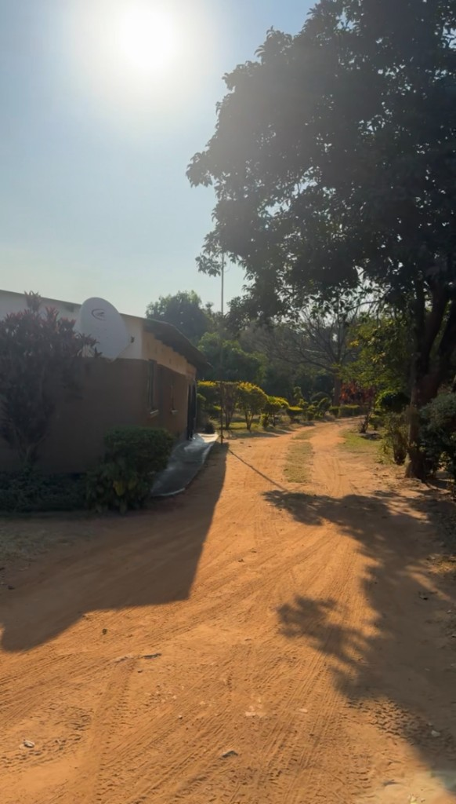

# Golden Emerald Guest House

A website for Golden Emerald Guest House, a family-run guest house on the M18 in Zambia. The goal is to make the business easier to find online and help it get more bookings.




## Features

- Landing page with an introduction to the guest house
- Room overview with rates (Standard, Family and Executive)
- Amenities and on-site food section
- Photo gallery
- Location section with an embedded Google Map
- Booking by phone and WhatsApp
- Responsive layout for mobile and desktop

## Tech stack

- ASP.NET Core Razor Pages (.NET 10)
- C#
- HTML and CSS

## Running locally

**Requirements:** [.NET 10 SDK](https://dotnet.microsoft.com/download)

```bash
git clone https://github.com/Phiri-Madalitso/Golden-Emerald-Guesthouse.git
cd Golden-Emerald-Guesthouse/WebApplication1
dotnet run
```

Then open the URL shown in the terminal.

## Project structure

```
WebApplication1/
├── Pages/          Razor Pages (Index, Privacy, Error, shared layout)
├── wwwroot/        Static files: CSS, JavaScript and images
└── Program.cs      App startup and request pipeline
```
